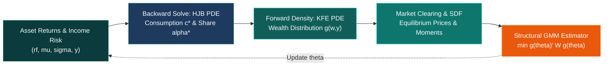
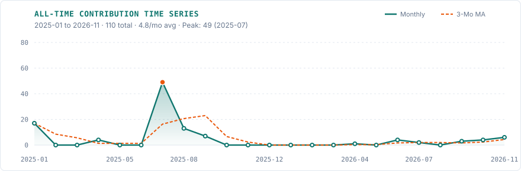

<!--
  GITHUB PROFILE README
  Duc Thanh (Timothy) Nguyen
  GitHub: https://github.com/timothynguyen-vnm
  Website: https://timothyducthanhnguyen.com/

  Aesthetic: Editorial Quantitative / Household Finance & Asset Pricing
  Palette: Deep Teal #0B3B3C | Teal #0F766E | Wharton Navy #1E3A5F | Burnt Orange #EA580C
-->

<div align="center">


<picture>
  <source media="(prefers-color-scheme: dark)" srcset="https://readme-typing-svg.demolab.com?font=JetBrains+Mono&weight=500&size=16&pause=1500&color=2DD4BF&center=true&vCenter=true&width=780&lines=Household+Finance+%26+Asset+Pricing+%40+The+Wharton+School%2C+UPenn;Heterogeneous-Agent+Macro+%C2%B7+Structural+Econometrics+%C2%B7+Fixed+Income;B.A.+Economics+%26+Mathematics+%40+Boston+University;Stata+%C2%B7+Python+%C2%B7+R+%C2%B7+SQL+%C2%B7+MATLAB+%C2%B7+LaTeX" />
  <source media="(prefers-color-scheme: light)" srcset="https://readme-typing-svg.demolab.com?font=JetBrains+Mono&weight=500&size=16&pause=1500&color=0F766E&center=true&vCenter=true&width=780&lines=Household+Finance+%26+Asset+Pricing+%40+The+Wharton+School%2C+UPenn;Heterogeneous-Agent+Macro+%C2%B7+Structural+Econometrics+%C2%B7+Fixed+Income;B.A.+Economics+%26+Mathematics+%40+Boston+University;Stata+%C2%B7+Python+%C2%B7+R+%C2%B7+SQL+%C2%B7+MATLAB+%C2%B7+LaTeX" />
  
</picture>

<br/><br/>

<a href="https://timothyducthanhnguyen.com/">
  
</a>
&nbsp;
<a href="https://timothyducthanhnguyen.com/assets/Nguyen_CV.pdf">
  
</a>
&nbsp;
<a href="https://timothyducthanhnguyen.com/research.html">
  
</a>
&nbsp;
<a href="https://www.linkedin.com/in/timothynguyen689/">
  
</a>
&nbsp;
<a href="mailto:ducthanh@wharton.upenn.edu">
  
</a>

<br/><br/>


&nbsp;

&nbsp;


</div>

---

```yaml
# researcher.yml
name: "Duc Thanh (Timothy) Nguyen"
affiliation: "Finance Department · The Wharton School, University of Pennsylvania"
location: "Philadelphia, PA"
interests: ["Household Finance", "Asset Pricing", "Empirical Macroeconomics", "Structural Econometrics"]
stack: ["Stata", "Python", "R", "SQL", "MATLAB", "LaTeX", "Git"]
```

---

## 01 / Focus & Affiliation

I am **Duc Thanh (Timothy) Nguyen**, a **Predoctoral Research Associate** in the Finance Department at **The Wharton School, University of Pennsylvania**. I earned my B.A. in Economics and Mathematics (*magna cum laude*, Minor in Business Administration) from **Boston University** in August 2026.

My research interests lie in **household finance and asset pricing**, with a methodological focus on structural econometrics, heterogeneous-agent macro-finance, and reproducible quantitative workflows. For my full academic background, see my [website](https://timothyducthanhnguyen.com/) and [CV](https://timothyducthanhnguyen.com/assets/Nguyen_CV.pdf).

<table>
<tr>
<td width="50%" valign="top">

### Research Agenda

- **Household Finance** — portfolio choice under uninsurable income risk, borrowing constraints, and wealth heterogeneity
- **Asset Pricing** — stochastic discount factors, risk premia, cross-sectional return predictability, and fixed income
- **Macro-Finance** — linking micro-level household balance sheets to aggregate equilibrium prices and dynamics

</td>
<td width="50%" valign="top">

### Methodological Pillars

- **Structural & Reduced-Form Synthesis** — bridging continuous-time portfolio theory with panel and Euler-equation evidence
- **Numerical & Econometric Rigor** — PDE/finite-difference solvers, GMM/SMM estimation, and HAC/clustered inference
- **Reproducible Pipelines** — deterministic `Stata` / `Python` / `MATLAB` / `SQL` workflows with clean audit trails

</td>
</tr>
</table>

---

## 02 / Frontier Macro-Finance Structural Framework

### Heterogeneous-Agent Portfolio Choice (HJB–KFE) & Asset Pricing GMM

At the frontier of **household finance and asset pricing**, incomplete-market heterogeneous-agent models couple **optimal household consumption–portfolio control** (HJB), the **endogenous cross-sectional wealth density** (Kolmogorov Forward Equation), and **cross-sectional Euler pricing moments**:

**1. Household Consumption–Portfolio HJB**

```math
\rho V_t(w, y) = \max_{c \ge 0, \quad \alpha \in \mathcal{A}} \left\lbrace u(c) + \partial_w V_t(w, y)\left[(r_t^f + \alpha(\mu_t - r_t^f))w + y - c\right] + \frac{1}{2}(\alpha \sigma_t w)^2 \partial_{ww} V_t(w, y) + \mathcal{L}_y V_t(w, y) + \partial_t V_t(w, y) \right\rbrace
```

**2. Endogenous Wealth–Income Distribution (Kolmogorov Forward PDE)**

```math
\partial_t g_t(w, y) = -\partial_w \left[\mu_t^w(w, y) g_t(w, y)\right] + \frac{1}{2}\partial_{ww}\left[(\alpha_t^{\ast} \sigma_t w)^2 g_t(w, y)\right] + \mathcal{L}_y^{\ast} g_t(w, y)
```

**3. Cross-Sectional SDF & Optimal Structural GMM Estimator**

```math
\mathbb{E}_t\left[ M_{t+1}(\theta) R_{i, t+1}^e \right] = 0, \qquad \hat{\theta}_{\mathrm{GMM}} = \arg\min_{\theta \in \Theta} \quad \bar{g}_T(\theta)^{\top} W_T \bar{g}_T(\theta)
```

| Equation | Structural & Econometric Role |
|:---|:---|
| **Portfolio-Choice HJB** (`V(w, y)`) | Backward-looking household consumption `c*` and risky portfolio share `alpha*` under uninsurable income risk and portfolio constraints |
| **Kolmogorov Forward PDE** (`g(w, y)`) | Forward evolution of the endogenous household wealth–income distribution aggregating micro balance sheets into market clearing |
| **Euler Moment & GMM** (`M(theta)`) | Stochastic discount factor pricing excess returns `R^e`, estimated via optimal two-step GMM weighting |



---

## 03 / Quantitative & Computing Stack

<div align="center">

<picture>
  <source media="(prefers-color-scheme: dark)" srcset="https://skillicons.dev/icons?i=py,r,matlab,mysql,postgres,pytorch,azure,git,github,vscode,latex&theme=dark" />
  <source media="(prefers-color-scheme: light)" srcset="https://skillicons.dev/icons?i=py,r,matlab,mysql,postgres,pytorch,azure,git,github,vscode,latex&theme=light" />
  
</picture>

<br/><br/>

**ECONOMETRICS, NUMERICAL COMPUTING & ML**


<br/>

**DATABASES, BI & VISUALIZATION**


<br/>

**TYPESETTING, CLOUD & REPRODUCIBILITY**


</div>

<br/>

| Layer | Methods, Systems & Tools |
|:---|:---|
| **Statistical & Numerical Computing** | Stata, Python, R, SQL, MATLAB |
| **Econometric Methodology** | GMM / SMM, panel fixed effects, IV/DiD, local projections, cross-sectional asset pricing |
| **Household Finance & Fixed Income** | Portfolio choice, yield-curve modeling, duration & convexity, risk attribution |
| **Data Engineering & Visualization** | Relational query optimization, panel/spatial linkage, Matplotlib, Power BI, Tableau |
| **Workflow & Spoken Languages** | Git, LaTeX, Jupyter, VS Code, Excel, Azure · **Languages:** English, Vietnamese, Spanish |

---

## 04 / Active Quantitative Builds

### Bond Investment Portfolio Analysis
`Fixed Income` · `Term Structure` · `Risk & Return` · *In Development*

Quantitative modeling of fixed-income portfolios examining yield-curve positioning, modified duration and convexity sensitivity, risk-return attribution, and interest-rate scenario stress testing in **Python** and **Excel**.

| Repository Focus | Core Quantitative Applications |
|:---|:---|
| **Household Finance & Asset Pricing** | Portfolio allocation models, SDF/Euler estimation, empirical risk-return tests |
| **Fixed-Income & Portfolio Analytics** | Yield-curve construction, duration/convexity hedging, scenario stress testing |
| **Data Engineering & Econometrics** | High-throughput SQL tuning, panel harmonization, reproducible workflows |

<div align="center">

<a href="https://github.com/timothynguyen-vnm?tab=repositories">
  
</a>

</div>

---

## 05 / GitHub Telemetry

<div align="center">

<a href="https://github.com/timothynguyen-vnm">
  <picture>
    <source media="(prefers-color-scheme: dark)" srcset="https://github-profile-summary-cards.vercel.app/api/cards/stats?username=timothynguyen-vnm&theme=github_dark" />
    <source media="(prefers-color-scheme: light)" srcset="https://github-profile-summary-cards.vercel.app/api/cards/stats?username=timothynguyen-vnm&theme=default" />
    
  </picture>
</a>
<a href="https://github.com/timothynguyen-vnm?tab=repositories">
  <picture>
    <source media="(prefers-color-scheme: dark)" srcset="https://github-profile-summary-cards.vercel.app/api/cards/repos-per-language?username=timothynguyen-vnm&theme=github_dark" />
    <source media="(prefers-color-scheme: light)" srcset="https://github-profile-summary-cards.vercel.app/api/cards/repos-per-language?username=timothynguyen-vnm&theme=default" />
    
  </picture>
</a>

<br/>

<picture>
  <source media="(prefers-color-scheme: dark)" srcset="https://streak-stats.demolab.com?user=timothynguyen-vnm&hide_border=true&background=00000000&ring=2DD4BF&fire=FB923C&currStreakLabel=2DD4BF&sideLabels=94A3B8&currStreakNum=F8FAFC&dates=94A3B8&sideNums=E2E8F0" />
  <source media="(prefers-color-scheme: light)" srcset="https://streak-stats.demolab.com?user=timothynguyen-vnm&hide_border=true&background=00000000&ring=0F766E&fire=EA580C&currStreakLabel=0F766E&sideLabels=64748B&currStreakNum=0F172A&dates=64748B&sideNums=334155" />
  
</picture>

<br/>

<picture>
  <source media="(prefers-color-scheme: dark)" srcset="./assets/all-time-contributions-dark.svg" />
  <source media="(prefers-color-scheme: light)" srcset="./assets/all-time-contributions-light.svg" />
  
</picture>

</div>

<sub>Public repository language metrics reflect code hosted on public GitHub rather than empirical research executed in Stata or restricted institutional environments.</sub>

---

## 06 / Beyond the Code & Connect

Strong empirical work is more than fitting a specification—it is asking a sharp economic question, respecting the data-generating process, and leaving behind code that anyone can audit and reproduce.

**Fun fact:** I once spent hours profiling execution plans and rewriting a single SQL query just to cut runtime down—it worked, and I genuinely enjoyed every minute of it.

<div align="center">

<br/>

**The Wharton School, University of Pennsylvania** · *3620 Locust Walk, Room 2300, Philadelphia, PA 19104-6367*

<br/>

<a href="mailto:ducthanh@wharton.upenn.edu">
  
</a>
&nbsp;
<a href="mailto:timothyducthanh.nguyen@gmail.com">
  
</a>
&nbsp;
<a href="https://www.linkedin.com/in/timothynguyen689/">
  
</a>
&nbsp;
<a href="https://timothyducthanhnguyen.com/">
  
</a>

<br/><br/>

<a href="https://www.hackerrank.com/dthanhng1">
  
</a>
&nbsp;
<a href="https://leetcode.com/timothynguyen/">
  
</a>
&nbsp;
<a href="https://instagram.com/timothynguyen.689">
  
</a>

<br/><br/>

**Household Finance × Asset Pricing × Econometrics**

*Curiosity drives the questions. Identification shapes the answers.*


</div>
