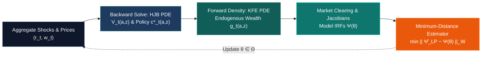

<!--
  GITHUB PROFILE README
  Duc Thanh (Timothy) Nguyen
  GitHub: https://github.com/timothynguyen-vnm
  Website: https://timothyducthanhnguyen.com/

  Aesthetic: Editorial Quantitative / Frontier Macroeconomics & Finance
  Palette: Slate #0F172A | Wharton Navy #1E3A5F | Teal #0F766E | Burnt Orange #EA580C
-->

<div align="center">


<picture>
  <source media="(prefers-color-scheme: dark)" srcset="https://readme-typing-svg.demolab.com?font=JetBrains+Mono&weight=500&size=16&pause=1500&color=2DD4BF&center=true&vCenter=true&width=780&lines=Empirical+Macroeconomics+%26+Finance+%40+The+Wharton+School%2C+UPenn;Heterogeneous-Agent+Macro+%C2%B7+Structural+Econometrics+%C2%B7+Fixed+Income;B.A.+Economics+%26+Mathematics+%40+Boston+University;Stata+%C2%B7+Python+%C2%B7+R+%C2%B7+SQL+%C2%B7+MATLAB+%C2%B7+LaTeX" />
  <source media="(prefers-color-scheme: light)" srcset="https://readme-typing-svg.demolab.com?font=JetBrains+Mono&weight=500&size=16&pause=1500&color=0F766E&center=true&vCenter=true&width=780&lines=Empirical+Macroeconomics+%26+Finance+%40+The+Wharton+School%2C+UPenn;Heterogeneous-Agent+Macro+%C2%B7+Structural+Econometrics+%C2%B7+Fixed+Income;B.A.+Economics+%26+Mathematics+%40+Boston+University;Stata+%C2%B7+Python+%C2%B7+R+%C2%B7+SQL+%C2%B7+MATLAB+%C2%B7+LaTeX" />
  
</picture>

<br/><br/>

<a href="https://timothyducthanhnguyen.com/">
  
</a>
&nbsp;
<a href="https://timothyducthanhnguyen.com/assets/Nguyen_CV.pdf">
  
</a>
&nbsp;
<a href="https://timothyducthanhnguyen.com/research.html">
  
</a>
&nbsp;
<a href="https://www.linkedin.com/in/timothynguyen689/">
  
</a>
&nbsp;
<a href="mailto:ducthanh@wharton.upenn.edu">
  
</a>

<br/><br/>


&nbsp;

&nbsp;


</div>

---

```yaml
# researcher.yml
name: "Duc Thanh (Timothy) Nguyen"
affiliation: "Finance Department · The Wharton School, University of Pennsylvania"
location: "Philadelphia, PA"
interests: ["Empirical Macroeconomics", "Macro-Finance", "Structural Econometrics", "Fixed Income"]
stack: ["Stata", "Python", "R", "SQL", "MATLAB", "LaTeX", "Git"]
```

---

## 01 / Focus & Affiliation

I am **Duc Thanh (Timothy) Nguyen**, a **Predoctoral Research Associate** in the Finance Department at **The Wharton School, University of Pennsylvania**, working with [Parinitha Sastry](https://fnce.wharton.upenn.edu/profile/psastry), [Victor Orestes](https://fnce.wharton.upenn.edu/profile/orestes/), and [Courtney Wiegand](https://fnce.wharton.upenn.edu/profile/cwiegand/). I earned my B.A. in Economics and Mathematics (*magna cum laude*, Minor in Business Administration) from **Boston University** in August 2026.

This GitHub hosts quantitative research utilities, fixed-income modeling, and reproducible econometric workflows. For my full academic background and research appointments, see my [website](https://timothyducthanhnguyen.com/) and [CV](https://timothyducthanhnguyen.com/assets/Nguyen_CV.pdf).

<table>
<tr>
<td width="50%" valign="top">

### Research Agenda

- **Empirical Macroeconomics** — aggregate transmission, international shocks, and dynamic impulse responses
- **Macro-Finance & Asset Pricing** — incomplete-market equilibrium, credit frictions, and risk premia
- **Fixed-Income Analytics** — term-structure modeling, yield-curve dynamics, and duration/convexity exposure

</td>
<td width="50%" valign="top">

### Methodological Pillars

- **Structural & Reduced-Form Synthesis** — bridging heterogeneous-agent theory with local-projection evidence
- **Numerical & Econometric Rigor** — finite-difference PDE solvers, GMM/SMD estimation, and HAC/clustered inference
- **Reproducible Pipelines** — deterministic `Stata` / `Python` / `MATLAB` / `SQL` workflows with clean audit trails

</td>
</tr>
</table>

---

## 02 / Frontier Macro Structural Framework

### Continuous-Time Heterogeneous-Agent Macro-Finance (HJB–KFE) & IRF Matching

Modern macro-finance pairs **incomplete-market heterogeneous-agent dynamics** (coupled Hamilton–Jacobi–Bellman and Kolmogorov Forward PDEs over an endogenous wealth distribution $g_t(a,z)$) with **impulse-response structural estimation** against empirical local projections:

$$
\begin{aligned}
\rho V_t(a, z) &= \max_{c \ge 0} \Big\{ u(c) + \partial_a V_t(a, z)\big(r_t a + w_t z - c\big) + \mathcal{A}_z V_t(a, z) + \partial_t V_t(a, z) \Big\} \\[8pt]
\partial_t g_t(a, z) &= -\partial_a \Big[ \big(r_t a + w_t z - c_t^*(a, z)\big)\, g_t(a, z) \Big] + \mathcal{A}_z^* g_t(a, z), \qquad \int_{\underline{a}}^{\infty}\!\int a\, g_t(a, z)\, dz\, da = K_t + B_t \\[8pt]
\hat{\theta} &= \arg\min_{\theta \in \Theta} \; \big(\widehat{\Psi} - \Psi(\theta)\big)^{\!\top} W_T \big(\widehat{\Psi} - \Psi(\theta)\big)
\end{aligned}
$$

| Equation / Object | Structural & Econometric Role |
|:---|:---|
| **HJB** $\; V_t(a, z)$ | Backward-looking household optimization under idiosyncratic income/productivity risk ($\mathcal{A}_z$) and borrowing limit $a \ge \underline{a}$ |
| **KFE** $\; g_t(a, z)$ | Forward evolution of the endogenous cross-sectional wealth density driven by optimal policy $c_t^*(a,z)$ and adjoint operator $\mathcal{A}_z^*$ |
| **IRF Matching** $\; \hat{\theta}$ | Minimum-distance estimator aligning transition/sequence-space model IRFs $\Psi(\theta)$ to empirical Jordà local-projection IRFs $\widehat{\Psi}$ |



---

## 03 / Quantitative & Computing Stack

<div align="center">

<picture>
  <source media="(prefers-color-scheme: dark)" srcset="https://skillicons.dev/icons?i=py,r,matlab,mysql,postgres,pytorch,azure,git,github,vscode,latex&theme=dark" />
  <source media="(prefers-color-scheme: light)" srcset="https://skillicons.dev/icons?i=py,r,matlab,mysql,postgres,pytorch,azure,git,github,vscode,latex&theme=light" />
  
</picture>

<br/><br/>

**ECONOMETRICS, NUMERICAL COMPUTING & ML**


<br/>

**DATABASES, BI & VISUALIZATION**


<br/>

**TYPESETTING, CLOUD & REPRODUCIBILITY**


</div>

<br/>

| Layer | Methods, Systems & Tools |
|:---|:---|
| **Statistical & Numerical Computing** | Stata, Python, R, SQL, MATLAB |
| **Econometric Methodology** | Local projections, structural estimation (GMM / SMD), panel fixed effects, IV/DiD, time series |
| **Fixed Income & Quantitative Finance** | Bond valuation, duration & convexity, yield-curve modeling, portfolio risk attribution |
| **Data Engineering & Visualization** | Relational query optimization, spatial & panel linkage, Matplotlib, Power BI, Tableau |
| **Workflow & Spoken Languages** | Git, LaTeX, Jupyter, VS Code, Excel, Azure · **Languages:** English, Vietnamese, Spanish |

---

## 04 / Active Quantitative Builds

### Bond Investment Portfolio Analysis
`Fixed Income` · `Term Structure` · `Risk & Return` · *In Development*

Quantitative modeling of fixed-income portfolios examining yield-curve positioning, modified duration and convexity sensitivity, risk-return attribution, and interest-rate scenario stress testing in **Python** and **Excel**.

| Repository Focus | Core Quantitative Applications |
|:---|:---|
| **Macro & Financial Econometrics** | Panel data pipelines, dynamic local projections, structural moment estimation |
| **Fixed-Income & Portfolio Analytics** | Yield-curve construction, duration/convexity hedging, scenario stress testing |
| **Data Engineering & Automation** | High-throughput SQL tuning, cross-dataset harmonization, reproducible reporting |

<div align="center">

<a href="https://github.com/timothynguyen-vnm?tab=repositories">
  
</a>

</div>

---

## 05 / GitHub Telemetry

<div align="center">

<a href="https://github.com/timothynguyen-vnm">
  <picture>
    <source media="(prefers-color-scheme: dark)" srcset="https://github-readme-stats.vercel.app/api?username=timothynguyen-vnm&show_icons=true&hide_border=true&include_all_commits=true&rank_icon=github&title_color=2DD4BF&icon_color=FB923C&text_color=CBD5E1&bg_color=00000000" />
    <source media="(prefers-color-scheme: light)" srcset="https://github-readme-stats.vercel.app/api?username=timothynguyen-vnm&show_icons=true&hide_border=true&include_all_commits=true&rank_icon=github&title_color=0F766E&icon_color=EA580C&text_color=334155&bg_color=00000000" />
    
  </picture>
</a>
<a href="https://github.com/timothynguyen-vnm?tab=repositories">
  <picture>
    <source media="(prefers-color-scheme: dark)" srcset="https://github-readme-stats.vercel.app/api/top-langs/?username=timothynguyen-vnm&layout=compact&hide_border=true&langs_count=6&title_color=2DD4BF&text_color=CBD5E1&bg_color=00000000" />
    <source media="(prefers-color-scheme: light)" srcset="https://github-readme-stats.vercel.app/api/top-langs/?username=timothynguyen-vnm&layout=compact&hide_border=true&langs_count=6&title_color=0F766E&text_color=334155&bg_color=00000000" />
    
  </picture>
</a>

<br/>

<picture>
  <source media="(prefers-color-scheme: dark)" srcset="https://streak-stats.demolab.com?user=timothynguyen-vnm&hide_border=true&background=00000000&ring=2DD4BF&fire=FB923C&currStreakLabel=2DD4BF&sideLabels=94A3B8&currStreakNum=F8FAFC&dates=94A3B8&sideNums=E2E8F0" />
  <source media="(prefers-color-scheme: light)" srcset="https://streak-stats.demolab.com?user=timothynguyen-vnm&hide_border=true&background=00000000&ring=0F766E&fire=EA580C&currStreakLabel=0F766E&sideLabels=64748B&currStreakNum=0F172A&dates=64748B&sideNums=334155" />
  
</picture>

<br/>

<picture>
  <source media="(prefers-color-scheme: dark)" srcset="https://github-readme-activity-graph.vercel.app/graph?username=timothynguyen-vnm&bg_color=00000000&color=94A3B8&line=2DD4BF&point=FB923C&area=true&area_color=14B8A6&hide_border=true&custom_title=Contribution%20Time%20Series" />
  <source media="(prefers-color-scheme: light)" srcset="https://github-readme-activity-graph.vercel.app/graph?username=timothynguyen-vnm&bg_color=00000000&color=475569&line=0F766E&point=EA580C&area=true&area_color=0F766E&hide_border=true&custom_title=Contribution%20Time%20Series" />
  
</picture>

</div>

<sub>Public repository language metrics reflect code hosted on public GitHub rather than empirical research executed in Stata or restricted institutional environments. Telemetry cards rely on third-party SVG renderers and may occasionally experience rate limits.</sub>

---

## 06 / Beyond the Code & Connect

Strong empirical work is more than fitting a specification—it is asking a sharp economic question, respecting the data-generating process, and leaving behind code that anyone can audit and reproduce.

**Fun fact:** I once spent hours profiling execution plans and rewriting a single SQL query just to cut runtime down—it worked, and I genuinely enjoyed every minute of it.

<div align="center">

<br/>

**The Wharton School, University of Pennsylvania** · *3620 Locust Walk, Room 2300, Philadelphia, PA 19104-6367*

<br/>

<a href="mailto:ducthanh@wharton.upenn.edu">
  
</a>
&nbsp;
<a href="mailto:timothyducthanh.nguyen@gmail.com">
  
</a>
&nbsp;
<a href="https://www.linkedin.com/in/timothynguyen689/">
  
</a>
&nbsp;
<a href="https://timothyducthanhnguyen.com/">
  
</a>

<br/><br/>

<a href="https://www.hackerrank.com/dthanhng1">
  
</a>
&nbsp;
<a href="https://leetcode.com/timothynguyen/">
  
</a>
&nbsp;
<a href="https://instagram.com/timothynguyen.689">
  
</a>

<br/><br/>

**Economics × Mathematics × Empirical Finance**

*Curiosity drives the questions. Identification shapes the answers.*


</div>

